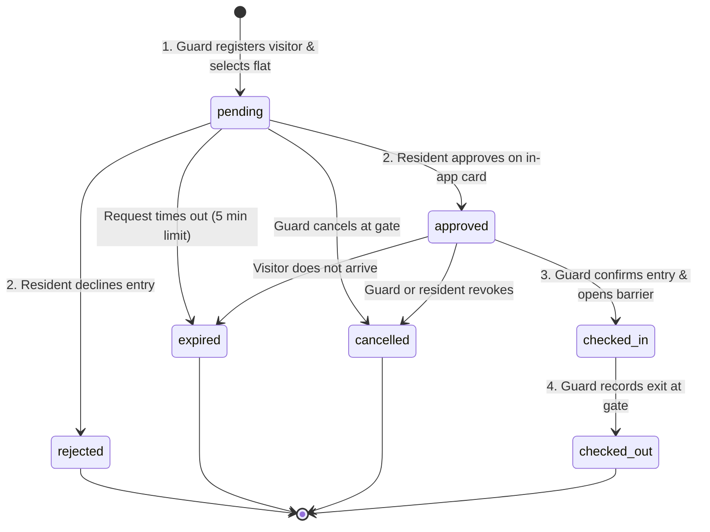

# Gateway Security (द्वारपाल) — Apartment Visitor Management System

**Gateway Security** is an enterprise-grade, mobile-first visitor management web application purpose-built for gated apartments and large residential communities in India. It replaces manual paper visitor registers with an instantaneous digital verification pipeline: touch-friendly guard gate terminals, WebRTC camera photo capture, real-time resident approval cards, and PostgreSQL multi-tenant Row Level Security (RLS).

---

## 🌟 Highlights & Key Features

- **📱 Mobile-First Security Guard Terminal (`/guard`)**:
  - High-contrast, large touch-target buttons tailored for gate tablets and mobile phones.
  - Quick Visitor Registration with Indian phone format validation (`+91 98XXX-XXXXX`).
  - WebRTC live camera capture with Indian Digital Personal Data Protection (DPDP) Act privacy consent notice.
  - Destination apartment hierarchy selector (Building / Tower -> Floor -> Flat) with instant display of verified resident name and intercom number.
  - Live approval wait screen with dynamic countdown timer and audio chime notifications.
  - Visual status transformations: Green Approved checkmark, Red Rejected cross, and Expired/Cancelled states.
  - Active visitors currently inside monitor with one-touch check-out.
  - 6-digit Pre-Approved Guest Pass verification (PIN / OTP).
  - Supervisor escalation and SOS emergency hotline trigger.

- **🏡 Resident & Family Portal (`/resident`)**:
  - Secure tenant-isolated portal for Flat B-402 (Begonia Tower).
  - Real-time incoming visitor cards featuring high-resolution visitor photograph, masked phone number (`+91 98XXX-XX334`), arrival gate, and purpose.
  - 1-tap **Approve** and **Deny** buttons with mandatory safety confirmation dialogs to prevent accidental taps.
  - Time-limited Pre-Approved Guest Pass generator (`/resident/passes`) with 6-digit PIN and shareable WhatsApp / SMS invitation message.
  - Authorized Family Members management (`/resident/family`) for co-residents.
  - Notification and audio chime preferences (`/resident/settings`).

- **🏢 Community Admin Dashboard (`/admin`)**:
  - Comprehensive operational KPIs: Visitors Today, Currently Inside, Pending Approvals, Rejected Requests, and Turnaround metrics.
  - Visitor breakdown charts (Deliveries vs Personal Guests vs Cabs vs Home Services).
  - Buildings, blocks, floors, and flats directory (`/admin/flats`) with intercom numbers and resident associations.
  - Security staff and gate station deployments (`/admin/staff`).
  - Filterable Visitor Reports with downloadable **CSV Export** (`/admin/reports`).
  - Immutable security audit logs and DPDP 90-day retention policies (`/admin/audit`).

- **🌐 Multi-Tenant Super Admin Console (`/super-admin`)**:
  - Oversight across multiple residential complexes (e.g., Prestige Lakeside Habitat, Sobha Dream Acres, Godrej Woods, DLF Magnolias).
  - Tenant database health and Supabase RLS partition verification.

---

## 🛠️ Technology Stack

- **Framework**: Next.js 16 (App Router, Turbopack, React 19, TypeScript)
- **Styling**: Tailwind CSS with custom Security Design Tokens (Navy Deep `#0B132B`, Emerald Check `#10B981`, Crimson Alert `#EF4444`, Amber Warning `#F59E0B`)
- **Icons**: Lucide React
- **Database & Auth**: Supabase PostgreSQL with Row Level Security (RLS)
- **Realtime**: Multi-tab synchronization via BroadcastChannel & Supabase Realtime Channels
- **Storage**: Supabase Private Bucket (`visitor-photos`) with 15-minute signed token access
- **Sound Engine**: Web Audio API synthesizer for gate approval chimes and alert bells
- **Tests**: Automated unit and state-machine validation suite with `node:test`

---

## 🔄 The 8-Step Visitor State Machine



### Safety Rules Enforced:
1. Direct transition from `pending` to `checked_in` is strictly prohibited. Guard cannot bypass resident decision.
2. Rejected requests cannot be checked in.
3. Check-out requires active `checked_in` status.
4. Terminal statuses (`rejected`, `expired`, `cancelled`, `checked_out`) are immutable.

---

## 🚀 Quick Start & Local Development

### 1. Prerequisites
- Node.js 18+ (Node 20+ or 24 recommended)
- npm 9+

### 2. Installation
```bash
# Clone or navigate to the project directory
cd gateway-security

# Install dependencies
npm install
```

### 3. Environment Configuration
Copy the template environment file:
```bash
cp .env.example .env.local
```
*(The application includes a built-in reactive data engine and seed dataset for Prestige Lakeside Habitat out of the box, allowing full interactive testing even before configuring Supabase credentials).*

### 4. Run the Development Server
```bash
npm run dev
```
Open [http://localhost:3000](http://localhost:3000) in your web browser.

### 5. Run Automated Tests
```bash
npm test
```

---

## 🗄️ Database Migrations (Supabase PostgreSQL)

Production-ready migrations are located in the `/migrations` directory:

| Migration File | Description |
| :--- | :--- |
| `01_init_schema.sql` | Creates extensions (`uuid-ossp`, `pgcrypto`), enums (`user_role`, `visitor_status`, `visitor_category`), tables (`communities`, `gates`, `buildings_blocks`, `flats`, `user_profiles`, `flat_residents`, `guest_passes`, `visitor_requests`, `audit_logs`), and b-tree indexes. |
| `02_rls_policies.sql` | Establishes Row Level Security policies enforcing community-level tenant isolation, guard-restricted insertions, resident flat-isolated queries, and strict status updates. |
| `03_seed_data.sql` | Seeds realistic Indian residential complex data for Prestige Lakeside Habitat (Bengaluru), Towers A-D, Flats 101-1404, Gates 1-3, sample visitors, and pre-approved passes. |
| `04_storage_setup.sql` | Configures private storage bucket (`visitor-photos`) with 5MB file size limits and RLS policies ensuring photos are accessible only via authorized signed URLs. |

### Applying to Live Supabase:
1. Open your Supabase Project Dashboard -> **SQL Editor**.
2. Run `migrations/01_init_schema.sql`.
3. Run `migrations/02_rls_policies.sql`.
4. Run `migrations/03_seed_data.sql`.
5. Run `migrations/04_storage_setup.sql`.
6. Add your project credentials to `.env.local`:
   ```env
   NEXT_PUBLIC_SUPABASE_URL=https://your-project.supabase.co
   NEXT_PUBLIC_SUPABASE_ANON_KEY=your-anon-key
   SUPABASE_SERVICE_ROLE_KEY=your-service-role-key
   ```

---

## 👥 Demo Testing Accounts (1-Click Switcher)

Gateway Security includes a built-in persona switcher located at the top-right of the navigation header:

| Role | Demo User Name | Scope / Associated Flat | Email |
| :--- | :--- | :--- | :--- |
| **Security Guard** | Ramesh Kumar | Main North Gate 1 (Boom Barrier Terminal) | `ramesh.guard@prestige.in` |
| **Resident (Owner)** | Ananya Sharma | Tower B - Begonia / Flat 402 | `ananya.sharma@gmail.com` |
| **Authorized Family** | Vikram Sharma | Tower B - Begonia / Flat 402 | `vikram.sharma@gmail.com` |
| **Community Admin** | Rajesh Iyer | Estate Manager (All Towers & Gates) | `rajesh.admin@prestige.in` |
| **Super Admin** | Dev Administrator | Multi-Community Global Oversight | `superadmin@gatewaysecurity.in` |

### Try the End-to-End Real-Time Flow:
1. Open `/guard/register` as **Ramesh Kumar (Guard)**.
2. Select Category **Delivery** -> Choose **Swiggy** -> Enter Visitor Name & Phone -> Snap or select a photo.
3. Destination Flat: Select **Tower B - Begonia / Flat 402** -> Click **REQUEST ENTRY APPROVAL NOW**.
4. You will be taken to the live pending screen with an amber pulsing ring.
5. In the top-right header, switch persona to **Ananya Sharma (Resident)** or open a second browser window at `/resident`.
6. The resident screen will sound an alert chime and display the visitor approval card.
7. Click **APPROVE ENTRY** -> Confirm in the modal.
8. Switch back to the guard screen: it will immediately transition to **VIBRANT GREEN APPROVED** with an approval chime!
9. Guard clicks **CONFIRM CHECK-IN & PERMIT ENTRY** to open the gate barrier.
10. The visitor is now listed in **Currently Inside**. Click **CHECK OUT** when they exit!

---

## 🔒 Security & Privacy Architecture

1. **Tenant & Flat Isolation**: Row Level Security (RLS) ensures residents cannot see visitors belonging to other flats, and community admins cannot query data from outside their assigned `community_id`.
2. **Private Storage**: Visitor photographs are stored in private storage with no public read permissions. Short-lived signed URLs (15-minute validity) are generated strictly for authorized guards and flat residents.
3. **Phone Masking**: Residents view masked phone numbers (`+91 98XXX-XX334`) to prevent phone scraping and protect delivery riders&apos; and guests&apos; privacy.
4. **DPDP Compliance**: Clear verbal/written consent notices are recorded upon photo capture, and automated 90-day retention policies scrub historical photos from storage.
5. **Double-Action Protection**: Important decisions (Approve, Deny, Check-In, Check-Out) require confirmation dialogs to prevent accidental taps on gate tablets or mobile screens.
6. **No Exposed Secrets**: `SUPABASE_SERVICE_ROLE_KEY` is strictly reserved for server-side environments and never bundled in client code.

---

## 🚢 Deployment

### Deploy to Vercel
```bash
npm install -g vercel
vercel
```
Set environment variables `NEXT_PUBLIC_SUPABASE_URL` and `NEXT_PUBLIC_SUPABASE_ANON_KEY` in your Vercel Project Settings.
